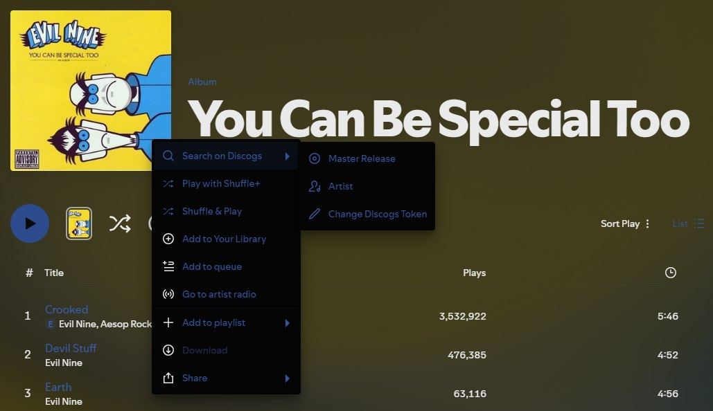

# Search on Discogs

A **Search on Discogs** menu for [Spicetify](https://spicetify.app). Right-click a song, album or artist in Spotify and jump straight to it on [Discogs](https://www.discogs.com).



## Features

- **Master Release:** opens the album's master release. If Discogs has no master, it opens the release instead. Works on albums and songs.
- **Artist:** opens the artist's page. On a song or album, it uses the first artist.
- **Track:** searches Discogs for the song's artist and title (songs only)
- **Straight to the page:** it opens the best match itself. If Discogs finds nothing, you get its search page instead.
- **Looks native:** the menu uses Spotify's own icons

## Install

1. Download [`discogs-context.js`](discogs-context.js).
2. Put it in your Spicetify `Extensions` folder. To find that folder, run `spicetify path userdata` and look inside it for `Extensions`.
3. Run:
   ```
   spicetify config extensions discogs-context.js
   spicetify apply
   ```

## Discogs token

Discogs only lets signed-in apps search its database, so the extension needs a personal access token from your Discogs account. It asks for one the first time you use it.

1. Open [discogs.com/settings/developers](https://www.discogs.com/settings/developers) and sign in.
2. Under **Personal access token**, click **Generate new token**. If you already have one, click **Copy token** instead.
3. Paste it into the box Spotify shows you and click **Save Token**.

To change or remove it later, right-click anything and choose **Search on Discogs → Change Discogs Token**. Save an empty box to remove it. If Discogs rejects the token, the extension forgets it and asks again.

The token gives access to your Discogs account, so keep it to yourself. The extension stores it only on your computer, in Spotify's local storage, and sends it only to Discogs, and it only uses it to search.

## Requirements

Tested on Spotify 1.3.6 with Spicetify 2.46.
